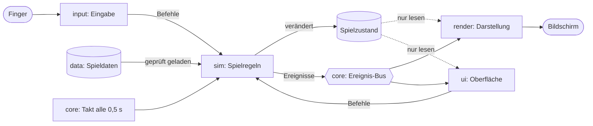

# Architektur – der Bauplan von Kontor & Krone

Dieses Dokument beschreibt, wie die Teile des Spiels zusammenarbeiten.
Es gilt für alle Phasen. Wer Code schreibt, hält sich daran; Änderungen werden hier und in [ENTSCHEIDUNGEN.md](ENTSCHEIDUNGEN.md) festgehalten.

- **Stand:** 18.11.2026 · Unterphase 1.6
- **Status:** 📝 Entwurf, wartet auf die Zustimmung des Nutzers

---

## 1. Auf einen Blick: das Spiel als Brettspiel

Stell dir Kontor & Krone als Brettspiel vor, das von einer Fernsehkamera gefilmt wird.

| Im Brettspiel | Im Code | Ordner |
| --- | --- | --- |
| **Spielbrett mit allen Figuren und Notizzetteln** – alles, was gerade gilt | **Spielzustand** | `sim/` |
| **Spielleiter**, der die Regeln anwendet und das Brett verändert | **Simulation** (Spiellogik) | `sim/` |
| **Regelbuch und Kartenkatalog** – welche Waren und Gebäude es gibt | **Spieldaten** (JSON-Dateien) | `data/` |
| **Rundenglocke**, die alle 0,5 Sekunden läutet | **Wirtschafts-Takt** | `core/` |
| **Lautsprecher-Durchsagen** („Holz +2!“) | **Ereignis-Bus** | `core/` |
| **Würfel mit Startnummer**: gleiche Nummer, gleiche Würfe | **Zufallsgenerator mit Seed** | `core/` |
| **Wunschzettel** des Spielers an den Spielleiter („Bitte baue hier einen Holzfäller“) | **Befehle** | `sim/` |
| **Hände des Spielers** | **Eingabe** (Touch) | `input/` |
| **Fernsehkamera**, die das Brett hübsch filmt – sie darf nichts verschieben | **Darstellung** (Babylon.js) | `render/` |
| **Anzeigetafel und Knöpfe** am Spieltisch | **Bedienoberfläche** | `ui/` |
| **Regie**, die vor Spielbeginn alles aufbaut und verbindet | **Start und Spiel-Schleife** | `app/` |
| **Prüfgeräte** des Technikers | **Debug-Werkzeuge** | `debug/` |

**Die wichtigste Regel:** Der Spielleiter (Simulation) weiß nichts von der Kamera (Grafik).
Die Kamera schaut nur zu und reagiert auf Durchsagen. Deshalb kann man die Spielregeln ohne Grafik testen, Spielstände einfach speichern und die Grafik später austauschen (Phase 8), ohne die Regeln anzufassen.

## 2. Diagramm



Kurz: **Befehle gehen hinein, Ereignisse kommen heraus.** Dazwischen liegt nur die Simulation.

## 3. Schichten und Ordner

| Ordner | Aufgabe | darf benutzen |
| --- | --- | --- |
| `core/` | Takt, Ereignis-Bus, Zufall, später Speicher-Format und Versionen | nichts anderes |
| `data/` | Spieldaten (JSON), Prüfschemas, Daten-Lader | `core` |
| `sim/` | Spielzustand, Spielregeln, Befehle | `core`, `data` |
| `render/` | 3D-Darstellung mit Babylon.js | `core`, `data`, `sim` (nur lesen) |
| `input/` | Finger-Eingaben in Befehle übersetzen | `core`, `sim`, `render` (um angetippte 3D-Objekte zu finden) |
| `ui/` | Bedienoberfläche (HTML) | `core`, `data`, `sim` – **kein** Babylon.js |
| `debug/` | Prüfhilfen (Geräte-Check, Debug-Anzeige) | alles |
| `app/` | Start, Spiel-Schleife, Versionsprüfung: verbindet alle Teile | alles |

`main.ts` ruft nur `app/` auf. Die bisherigen Dateien `core/buildInfo.ts` und `core/updateCheck.ts` ziehen nach `app/` um, weil sie den Browser brauchen.

**Automatische Kontrolle:** ESLint (der „Rechtschreibprüfer“ für Code) prüft diese Tabelle bei jedem Bauen.
Ein verbotener Import, z. B. Babylon.js in `sim/`, ist ein Fehler. Dann wird auch nichts veröffentlicht.
Zusätzlich sind in `core/`, `data/` und `sim/` verboten: Browser-Zugriffe (`window`, `document` …), `Math.random()` und die Uhrzeit (`Date.now()`).
Dadurch rechnet die Simulation auf jedem Gerät exakt gleich (siehe Abschnitt 8).

## 4. Der Spielzustand

Alles, was ein Spielstand enthalten muss, steht in **einem** Objekt: dem Spielzustand.

- **Nur einfache Daten:** Zahlen, Texte, Ja/Nein, Listen und einfache Objekte. Keine 3D-Objekte, keine Funktionen.
  Dadurch lässt er sich jederzeit 1 : 1 als Text (JSON) speichern und wieder laden.
- **Verweise über Nummern (IDs):** Ein Marktkarren merkt sich nicht „das Lagerhaus-Objekt“, sondern „Gebäude Nr. 17“.
  Wie Hausnummern statt Wegbeschreibungen: Nach dem Laden stimmen die Nummern immer noch.
  - Dinge auf der Karte (Gebäude, Karren, Schiffe) bekommen fortlaufende Nummern.
  - Dinge aus den Spieldaten (Waren, Gebäudearten) haben feste englische Namen, z. B. `wood`.
- **Versionsnummer:** Jeder Spielstand trägt eine Versionsnummer (`saveVersion`). Ändert sich später der Aufbau, wandelt ein kleines Umbau-Programm alte Spielstände automatisch um („Migration“).
- **Nur die Simulation darf ihn ändern.** Darstellung und Oberfläche bekommen eine schreibgeschützte Sicht; TypeScript meldet jeden Änderungsversuch als Fehler.

Beispiel (vereinfacht, so ähnlich nach Phase 1):

```json
{
  "saveVersion": 1,
  "seed": 1701,
  "random": { "world": [1, 2, 3, 4], "events": [5, 6, 7, 8] },
  "tick": 1240,
  "nextEntityId": 3,
  "buildings": { "1": { "id": 1, "type": "test_woodcutter" } },
  "storage": { "wood": 2480 }
}
```

Die Spielgeschwindigkeit gehört nicht zum Spielzustand, sondern zur Uhr (Abschnitt 5).

## 5. Die Uhr: Wirtschafts-Takt und Zeichen-Takt

Das Spiel hat zwei getrennte Takte, wie ein Uhrwerk mit zwei Rädern:

**Wirtschafts-Takt (Simulation):** genau alle 0,5 Sekunden Spielzeit, egal wie schnell das Tablet zeichnet.
Pro Takt rechnet die Simulation einmal alles durch: Produktion, Verbrauch, Steuern.

| Tempo | Takte pro Sekunde |
| --- | --- |
| Pause | 0 |
| 1× | 2 |
| 2× | 4 |
| 4× | 8 |

**Schutz vor der „Aufhol-Lawine“:** Hängt das Tablet kurz oder war das Spiel im Hintergrund, würde eine einfache Uhr alle verpassten Takte auf einmal nachholen – das Spiel friert ein, holt auf, friert wieder ein.
Deshalb zählt pro Bild höchstens eine Viertelsekunde echte Zeit. Was darüber liegt, verfällt: Das Spiel läuft dann kurz langsamer, statt zu ruckeln.
Im Hintergrund (andere App, Bildschirm aus) zeichnet Chrome nichts, also steht das Spiel still. Es verpasst nichts.

**Zeichen-Takt (Darstellung):** höchstens 60 Bilder pro Sekunde (E-015), siehe Abschnitt 9.

**Bewegungen (Karren, Schiffe, Figuren) – das „Fahrplan-Prinzip“:**
Die Simulation speichert nicht laufend die Position, sondern einen Fahrplan: „Karren 5 fährt in Takt 1200 von A nach B, Geschwindigkeit 2 Felder pro Takt.“
Wie bei der Bahn: Mit dem Fahrplan weiß man jederzeit, wo der Zug gerade ist, ohne nachzusehen.
Die Darstellung rechnet daraus bei jedem Bild die genaue Position aus, auch zwischen zwei Takten („Interpolation“). So gleiten Karren weich mit 60 Bildern pro Sekunde, obwohl die Simulation nur 2-mal pro Sekunde rechnet.
**Ein feinerer Takt für Bewegungen ist deshalb nicht nötig.** Das spart viel Rechenzeit, und Ankünfte passieren trotzdem genau im richtigen Takt.

## 6. Befehle und Ereignisse

**Befehle (Spieler → Simulation):** Jede Spieler-Aktion wird ein kleines Datenpaket, z. B. `{ type: "placeBuilding", building: "woodcutter", x: 10, y: 4 }`.
- Die Simulation prüft und führt ihn **sofort** aus, auch in der Pause (man soll in Ruhe planen können).
- Antwort: „erledigt“ oder ein deutscher Grund, z. B. „Nicht genug Holz“.
- Vorteile: Jede Aktion ist automatisch testbar. Später lässt sich daraus „Rückgängig“ bauen.

**Ereignisse (Simulation → Darstellung und Oberfläche):** Die Simulation macht Durchsagen über den Ereignis-Bus, z. B. „Takt 1240 fertig“, „Lager: Holz jetzt 2480“, „Gebäude 17 gebaut“.
- Wer sich für eine Durchsage interessiert, meldet sich dafür an („Beobachter-Prinzip“).
- Durchsagen werden gesammelt und erst **nach** einem Takt oder Befehl verteilt. So sieht jeder Zuhörer einen fertigen, stimmigen Spielzustand.
- Typisiert: TypeScript kennt jede Durchsage und ihren Inhalt; ein Tippfehler im Namen fällt sofort auf.
- Durchsagen sind nur Hinweise. Die Wahrheit steht immer im Spielzustand.

## 7. Spieldaten in Datendateien

Waren, Gebäude, Produktionsketten, Bevölkerungsstufen usw. stehen in **JSON-Dateien** in `src/data/` (z. B. `goods.json`, `buildings.json`), nicht im Code.
Englische Namen als feste Kennung, deutsche Texte für die Anzeige:

```json
[{ "id": "wood", "name": "Holz" }]
```

**Prüfschema:** Für jede Datei gibt es ein Schema, eine Art Formular-Vorlage: Welche Felder gibt es, welche Art von Wert, welche Grenzen?
Beim Laden wird jede Datei damit kontrolliert, danach die Querverweise (Gibt es die Ware, die ein Gebäude herstellt? Ist jede Kennung nur einmal vergeben?).
Fehler kommen als klare deutsche Meldung, z. B.:

> buildings.json → Eintrag 1 („test_woodcutter“) → Feld „produces“: Die Ware „holz“ gibt es nicht. Bekannte Waren: wood.

Geprüft wird **zweimal:** in den automatischen Tests (fehlerhafte Daten werden gar nicht erst veröffentlicht) und beim Spielstart (Sicherheitsnetz, später auch für geladene Spielstände).
Die Dateien werden beim Bauen ins Spiel gepackt; es gibt keine zusätzlichen Downloads.

**Werkzeug: zod** (Version 4, schlanke Variante „zod/mini“), siehe Abschnitt 12.

## 8. Zufall mit Seed

Ein Computer kann nicht wirklich würfeln. Ein Zufallsgenerator erzeugt aus einer Startnummer (dem **Seed**) eine Zahlenfolge, die zufällig aussieht.
Gleicher Seed → gleiche Folge → gleiche Inselwelt. So kann man eine schöne Karte per Nummer wiederholen oder weitergeben.

- Verfahren: „sfc32“, schnell und gut erprobt. Der Seed darf eine Zahl oder ein Wort sein („Barock“ wird in eine Zahl umgerechnet).
- **Getrennte Zufalls-Ströme** für Kartengenerator und Ereignisse. Kommt später ein neues Ereignis dazu, ändert sich die Karte zum selben Seed trotzdem nicht.
- Der Zustand der Generatoren steht im Spielstand. Nach dem Laden geht es exakt so weiter wie vorher.
- In der Simulation ist `Math.random()` verboten (ESLint), damit niemand versehentlich „echten“ Zufall nutzt.

## 9. Leistung (für das Budget-Tablet)

Grundlage sind die Zahlen in [LEISTUNGSBUDGET.md](LEISTUNGSBUDGET.md).

- **Viele gleiche Objekte → Thin Instances** (ein Zeichenauftrag pro Modell-Art), ab ca. 20 Stück: Bäume, Häuser, Felder, Zäune.
- **Wiederverwenden statt neu erzeugen („Pooling“):** Karren, Figuren, Schiffe und Effekte kommen aus einem Vorrat und gehen danach zurück. Wie Leihfahrräder: Ständiges Neukaufen und Wegwerfen kostet Zeit und führt zu kleinen Rucklern beim „Aufräumen“ des Arbeitsspeichers.
- **Unbewegliches einfrieren:** Gebäude und Gelände werden als „unbeweglich“ markiert; Babylon.js spart sich dann Rechenarbeit.
- **Bildraten-Begrenzer:** höchstens 60 Bilder pro Sekunde (E-015). Zum Vergleich am Tablet lässt sich per Link-Zusatz `?fps=45` ein anderer Wert testen.
- **Ruhebild (Akku schonen):** Bewegt sich nichts im Bild (kein Finger, Kamera steht, keine Animation), wird nur noch gezeichnet, wenn sich etwas ändert, plus ein Kontrollbild pro Sekunde. Sobald ein Finger den Bildschirm berührt oder sich etwas bewegt, sofort wieder bis zu 60 Bilder pro Sekunde.
  Mit viel „Gewusel“ (ab Phase 3) bewegt sich fast immer etwas. Ob es dann zusätzlich einen Akku-Modus nach längerer Untätigkeit gibt, entscheiden wir in Phase 9/10.
- **Simulation im Haupt-Programm:** Bei 2–8 Takten pro Sekunde ist sie sehr sparsam. Weil sie nichts von der Grafik weiß, könnte sie später in einen eigenen Rechenstrang („Web Worker“) umziehen, falls große Städte das nötig machen (Phase 10).

## 10. Bedienoberfläche: HTML/CSS über der 3D-Szene (Empfehlung)

Umgesetzt wird die Oberfläche erst in Phase 3. Die Technik legen wir jetzt fest.

| | **HTML/CSS über der Szene** (Empfehlung) | **Babylon GUI** (in der 3D-Szene gezeichnet) |
| --- | --- | --- |
| Schrift | gestochen scharf in jeder Größe | wird als Bild gezeichnet, kann leicht unscharf wirken |
| Gestaltung | mit CSS sehr flexibel, barocke Rahmen, Schriften, Schatten | aufwendiger, weniger Möglichkeiten |
| Leistung | belastet die 3D-Zeichnung nicht | jedes Element kostet Zeichenzeit |
| Download | kostet nichts extra | ca. 100 kB zusätzlich |
| Beschriftungen an 3D-Objekten (z. B. Sprechblasen) | Position muss umgerechnet werden (kleiner Zusatz-Code) | eingebaut |
| Touch | der Browser regelt alles, auch Scrollen in Listen | muss Babylon.js übernehmen |

Ein Hilfs-Baukasten für die Oberfläche (z. B. Preact oder Lit) wird erst in Phase 3 gewählt.

## 11. Ablauf eines Bildes

1. Ein Finger tippt → `input/` übersetzt das in einen Befehl → die Simulation führt ihn sofort aus.
2. Die Uhr misst die vergangene Zeit × Tempo und sagt: 0, 1 oder 2 Wirtschafts-Takte fällig.
3. Für jeden fälligen Takt rechnet die Simulation einmal durch.
4. Die gesammelten Durchsagen werden verteilt; Darstellung und Oberfläche passen sich an.
5. Der Bildraten-Begrenzer entscheidet: Ist ein neues Bild dran? Wenn ja, zeichnet die Darstellung es, Bewegungen weich zwischen zwei Takten.

## 12. Werkzeug für die Prüfschemas: zod

- **Gewählt (Vorschlag):** zod 4, schlanke Variante `zod/mini`, ca. 6 kB komprimiert.
- **Vorteile:** sehr verbreitet und gut gepflegt; eingebaute deutsche Fehlermeldungen; das Schema liefert gleichzeitig die TypeScript-Typen (eine Quelle statt zwei).
- **Nachteile:** Die schlanke Variante schreibt sich etwas umständlicher als die volle (27 kB). Die eingebauten Meldungen sind teils holprig („erwartet string“); wir übersetzen die häufigsten selbst in Alltagssprache.
- **Alternativen:** valibot (ähnlich klein, weniger verbreitet) · ajv mit JSON-Schema (Industriestandard, aber größer und mit englischen Meldungen).

## 13. Automatische Tests

| Was | Wie |
| --- | --- |
| Uhr | 10 Takte bei 1× dauern 5 s; Pause erzeugt keine Takte; 4× ist 4-mal so schnell; keine Aufhol-Lawine nach langer Pause |
| Ereignis-Bus | Durchsagen kommen beim richtigen Zuhörer an, erst nach dem Verteilen, Abmelden funktioniert |
| Zufall | gleicher Seed → gleiche Zahlen; getrennte Ströme beeinflussen sich nicht; Speichern und Fortsetzen ergibt dieselbe Folge |
| Spielzustand | Speichern als Text und Zurücklesen ergibt exakt denselben Zustand |
| Spieldaten | die echten Dateien sind gültig; absichtlich fehlerhafte Beispiel-Dateien liefern die erwartete deutsche Meldung |
| Simulation | gleicher Seed + gleiche Befehle → gleiches Ergebnis; Produktion pro Takt stimmt (ab 1.7) |
| Bildraten-Begrenzer | bei 90 Hz entstehen im Schnitt 60 Bilder pro Sekunde; Ruhebild greift und endet richtig |
| Schichten-Regeln | ESLint (Abschnitt 3) |

Darstellung und Oberfläche prüft Claude mit dem Bildschirmfoto-Skript im unsichtbaren Chrome; das Gefühl am Tablet prüft der Nutzer.
Alle Tests laufen vor jeder Veröffentlichung. Schlägt einer fehl, bleibt die alte Version online.

## 14. Was wann gebaut wird

- **Unterphase 1.6:** Uhr mit Tempo, Ereignis-Bus, Zufallsgenerator, Spielzustand mit Versionsnummer, Befehls-Grundgerüst, Daten-Lader mit Prüfschema, Bildraten-Begrenzer und Ruhebild, Schichten-Regeln in ESLint – alles mit Tests.
- **Unterphase 1.7:** Test-Ware „Holz“ als echte Datendatei, Test-Betrieb und Test-Lager, Debug-Anzeige.
- **Später:** Speichern/Laden im Browser-Speicher (Phase 3), Rückgängig (bei Bedarf), Oberflächen-Baukasten (Phase 3).
